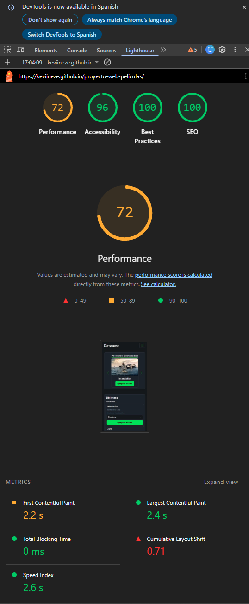
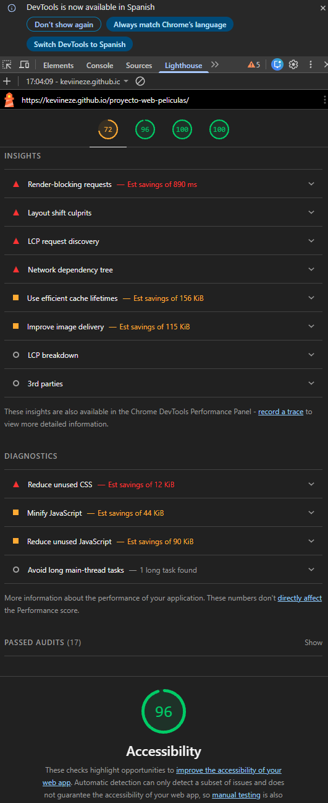
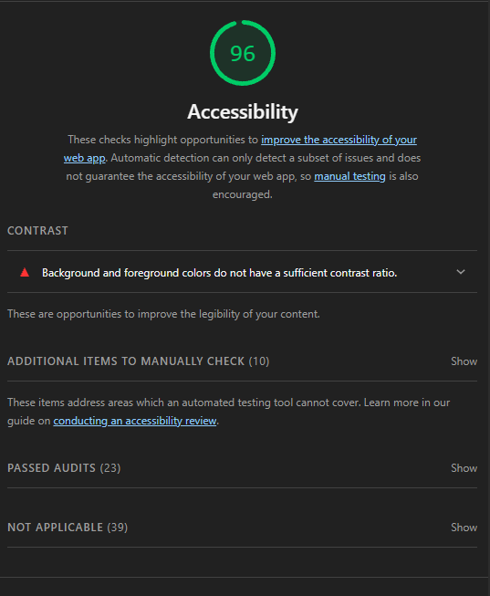
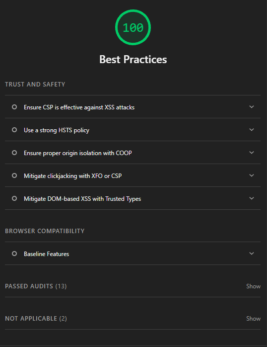
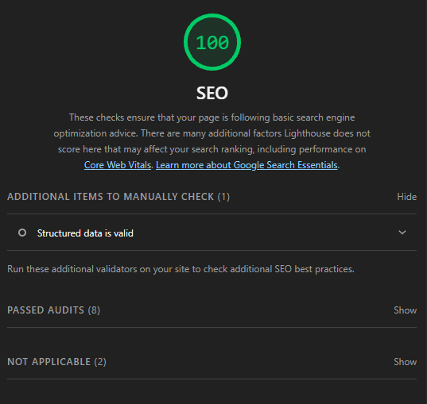

# Test Case 11: Auditoría Lighthouse - Baseline Inicial

## Información General
- **Fecha de ejecución:** 2026-11-26 — 17:04 (hora local)
- **URL testeada:** https://keviineze.github.io/proyecto-web-peliculas/
- **Rama:** release/cuarta-entrega (estado actual publicado en GitHub Pages; `develop` aún sin backport del Segundo Parcial)
- **Navegador:** Chrome 158.0.8127.88
- **Dispositivo de auditoría:** Mobile (predeterminado de Lighthouse)
- **Ejecución:** Chrome DevTools → pestaña Lighthouse → categorías Performance, Accessibility, Best Practices y SEO

## Umbrales Mínimos Definidos
- **Performance:** ≥ 95
- **Accessibility:** ≥ 95
- **Best Practices:** ≥ 95
- **SEO:** ≥ 95

> Nota de trazabilidad: la plantilla del parcial muestra ≥80 / ≥90 / ≥85 / ≥80 como ejemplo; se adoptan los ≥95 de la sección 4.3 y del rubro de puntaje.

> **Corrección metodológica (Code Review de la PR #128):** para una comparación estricta, los tres estados (baseline, post-fetch y post-librería) deben medirse sobre **la misma URL, con caché limpia y con mediana de 3 corridas**. En esta primera ronda el baseline se midió contra GitHub Pages y TC12/TC13 contra `localhost`; por ello solo se consideran directamente comparables entre orígenes las categorías **Accessibility, Best Practices y SEO** y, con cautela, el **CLS**. Las métricas de tiempo (FCP/LCP/Speed Index), render-blocking y cache lifetimes **no se usan para atribuir causalidad** entre orígenes; sí son válidas las comparaciones TC12 ↔ TC13 (mismo origen local). Detalle en la sección "Comparabilidad de las mediciones" de cada test case.

## Resultados Obtenidos

### Performance: 72 ❌ (umbral ≥ 95)
- First Contentful Paint: 2.2 s
- Largest Contentful Paint: 2.4 s
- Total Blocking Time: 0 ms
- Cumulative Layout Shift: **0.71** ← principal responsable del puntaje bajo
- Speed Index: 2.6 s

**Hallazgos (Insights / Diagnostics):**
- 🔴 Render-blocking requests — ahorro estimado de 890 ms
- 🔴 Layout shift culprits — origen del CLS 0.71
- 🔴 LCP request discovery — el recurso LCP se descubre tarde en el árbol de red
- 🔴 Network dependency tree
- 🟠 Use efficient cache lifetimes — ahorro estimado de 156 KiB
- 🟠 Improve image delivery — ahorro estimado de 115 KiB
- 🔴 Reduce unused CSS — ahorro estimado de 12 KiB
- 🟠 Minify JavaScript — ahorro estimado de 44 KiB
- 🟠 Reduce unused JavaScript — ahorro estimado de 90 KiB
- ⚪ Avoid long main-thread tasks — 1 tarea larga detectada

### Accessibility: 96 ✅ (umbral ≥ 95)
- **Problema encontrado:** *Background and foreground colors do not have a sufficient contrast ratio* (contraste insuficiente entre colores de fondo y primer plano).
- Passed audits: 23 · Not applicable: 39 · Ítems a verificar manualmente: 10.
- Aunque se cumple el umbral, el hallazgo se reporta como issue (ver "Issues Generadas").

### Best Practices: 100 ✅ (umbral ≥ 95)
- Sin observaciones que afecten el puntaje.
- Passed audits: 13 · Not applicable: 2 (ítems de CSP, HSTS, COOP, XFO y Trusted Types no aplican a la configuración actual del sitio).

### SEO: 100 ✅ (umbral ≥ 95)
- Sin observaciones: el puntaje alcanza el máximo.

## Cumplimiento de Umbrales

| Categoría | Umbral | Resultado | ¿Cumple? |
|---|---|---|---|
| Performance | ≥ 95 | 72 | ❌ |
| Accessibility | ≥ 95 | 96 | ✅ |
| Best Practices | ≥ 95 | 100 | ✅ |
| SEO | ≥ 95 | 100 | ✅ |

## Issues Generadas
- [#103] Optimizar tamaño y formato de imágenes para mejorar el LCP → @GonzaloBarbano (Coordinador/DevOps)
- [#104] Corregir layout shifts (CLS 0.71) detectados en el baseline → @GonzaloBarbano (Coordinador/DevOps)
- [#105] Eliminar render-blocking requests y reducir CSS/JS sin usar → @GonzaloBarbano (Coordinador/DevOps)
- [#106] Corregir contraste insuficiente entre texto y fondo → @GonzaloBarbano (Coordinador/DevOps)

> **Estado de resolución (2026-11-27):** las cuatro issues fueron cerradas por @GonzaloBarbano con motivo *"completed"*, sin comentarios ni correcciones verificables: en el TC12 y el TC13 los hallazgos siguen presentes (CLS 0.713, render-blocking 980/1.130 ms, contraste insuficiente). Se solicita reapertura o justificación de cierre ante el Coordinador/DevOps.

> Todas las issues del baseline se asignan al Coordinador/DevOps porque el Segundo Parcial no contempla un rol de Frontend/CSS; queda documentada la decisión de asignación y se coordinará la priorización con el Tester QA/JS (sección de Coordinación de la consigna).

## Conclusiones
El estado baseline del proyecto alcanza **96 en Accessibility, 100 en Best Practices y 100 en SEO**, cumpliendo tres de los cuatro umbrales definidos. **Performance queda en 72**, muy por debajo del ≥95, y concentra todas las mejoras pendientes: el **CLS de 0.71** (layout shifts) es la métrica crítica, seguido por **render-blocking requests (890 ms de ahorro estimado)**, **imágenes sin optimizar (115 KiB)** y **CSS/JS sin usar (102 KiB)**.

Este resultado es esperable para un baseline: su función es establecer el punto de partida y generar las issues de corrección. Se recomienda atacar CLS, imágenes y render-blocking **antes** de integrar el consumo de API, porque la fase post-fetch agregará llamadas de red y probablemente degrade aún más Performance; así el comparativo de los Test Cases 12 y 13 será más limpio.