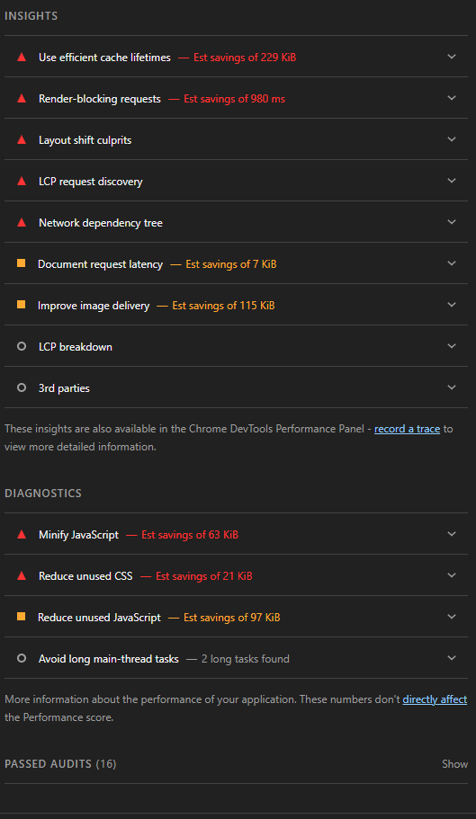
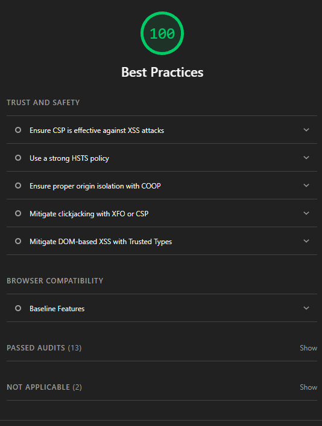
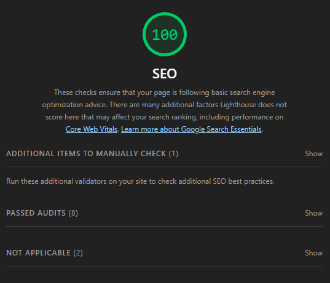

# Test Case 12: Auditoría Lighthouse - Post Fetch/API

## Información General
- **Fecha de ejecución:** 2026-11-27 — 22:36 a 22:38 (hora local)
- **URL testeada:** http://localhost:8001/ (servidor local `python -m http.server 8001`)
- **Estado auditado:** commit `0f8d075` — merge de la PR #124 (`feature/dev-async-fetch-api`) en `develop`, es decir, **solo** la integración de fetch, sin la librería externa (timing intermedio exigido por la consigna)
- **Navegador:** Chrome 158.0.8127.88
- **Dispositivo de auditoría:** Mobile (predeterminado de Lighthouse)
- **Ejecución:** Chrome DevTools → pestaña Lighthouse → categorías Performance, Accessibility, Best Practices y SEO
- **Cambios implementados (respecto al baseline):**
  - `js/api/apiService.js` con `fetchCatalog()` que consume `api/data.json` (6 títulos) vía `fetch()`
  - Estados de carga y error accesibles (`showLoading`, `hideLoading`, `showError` con botón "Reintentar")
  - Procesamiento de datos con `map`, `filter` y `reduce` (`processCollection`, `filterByCategory`, `calculateStats`)

> Nota de trazabilidad: el baseline (TC11) se corrió contra GitHub Pages y este estado contra un servidor local, porque GitHub Pages sigue publicando `release/cuarta-entrega` sin las features del parcial. Se mantienen idénticos máquina, navegador, preset Mobile, red y versión de Lighthouse; solo cambia el origen de servicio (localhost vs. Pages). El hallazgo *"Use efficient cache lifetimes"* se toca con reservas en este entorno, ver análisis de impacto.

## Umbrales Mínimos Definidos
- **Performance:** ≥ 95 · **Accessibility:** ≥ 95 · **Best Practices:** ≥ 95 · **SEO:** ≥ 95

## Resultados Obtenidos

### Performance: 72 ❌ (umbral ≥ 95)
- First Contentful Paint: 1.9 s
- Largest Contentful Paint: 2.6 s
- Total Blocking Time: 0 ms
- Cumulative Layout Shift: **0.713** ← principal responsable del puntaje bajo (mismo problema del baseline)
- Speed Index: 1.9 s

**Hallazgos (Insights / Diagnostics):**
- 🔴 Render-blocking requests — ahorro estimado de 980 ms
- 🔴 Use efficient cache lifetimes — ahorro estimado de 229 KiB
- 🔴 Layout shift culprits — origen del CLS 0.713
- 🔴 LCP request discovery
- 🔴 Network dependency tree
- 🟠 Document request latency — ahorro estimado de 7 KiB
- 🟠 Improve image delivery — ahorro estimado de 115 KiB
- 🔴 Minify JavaScript — ahorro estimado de 63 KiB
- 🔴 Reduce unused CSS — ahorro estimado de 21 KiB
- 🟠 Reduce unused JavaScript — ahorro estimado de 97 KiB
- ⚪ Avoid long main-thread tasks — 2 tareas largas detectadas (baseline: 1)
- Passed audits: 16

### Accessibility: 96 ✅ (umbral ≥ 95)
- **Problema persistente del baseline:** *Background and foreground colors do not have a sufficient contrast ratio* (contraste insuficiente) → issue #106.
- Passed audits: 23 · Not applicable: 39 · Ítems a verificar manualmente: 10.
- La integración de fetch **no agregó** nuevos fallos de accesibilidad: los estados de carga/error usan `role="status"` y `role="alert"` con `aria-live="polite"`.

### Best Practices: 100 ✅ (umbral ≥ 95)
- Sin observaciones que afecten el puntaje.
- Passed audits: 13 · Not applicable: 2.

### SEO: 100 ✅ (umbral ≥ 95)
- Sin observaciones: el puntaje alcanza el máximo.
- Passed audits: 8 · Not applicable: 2 · Ítems a verificar manualmente: 1.

## Cumplimiento de Umbrales

| Categoría | Umbral | Baseline (TC11) | Post-Fetch (TC12) | Diferencia | ¿Cumple? |
|---|---|---|---|---|---|
| Performance | ≥ 95 | 72 | 72 | 0 | ❌ |
| Accessibility | ≥ 95 | 96 | 96 | 0 | ✅ |
| Best Practices | ≥ 95 | 100 | 100 | 0 | ✅ |
| SEO | ≥ 95 | 100 | 100 | 0 | ✅ |

## Comparación con Baseline

### Métricas de rendimiento

| Métrica | Baseline (TC11) | Post-Fetch (TC12) | Diferencia |
|---------|----------|------------|------------|
| First Contentful Paint | 2.2 s | 1.9 s | −0.3 s ✅ |
| Largest Contentful Paint | 2.4 s | 2.6 s | +0.2 s ⚠️ |
| Total Blocking Time | 0 ms | 0 ms | 0 ✅ |
| Cumulative Layout Shift | 0.71 | 0.713 | +0.003 ⚠️ (sin corrección) |
| Speed Index | 2.6 s | 1.9 s | −0.7 s ✅ |

### Hallazgos de Insights / Diagnostics

| Hallazgo | Baseline (TC11) | Post-Fetch (TC12) | Diferencia |
|----------|----------|------------|------------|
| Render-blocking requests | 890 ms | 980 ms | +90 ms ⚠️ |
| Use efficient cache lifetimes | 156 KiB | 229 KiB | +73 KiB ⚠️ * |
| Improve image delivery | 115 KiB | 115 KiB | 0 |
| Reduce unused CSS | 12 KiB | 21 KiB | +9 KiB ⚠️ |
| Reduce unused JavaScript | 90 KiB | 97 KiB | +7 KiB ⚠️ |
| Minify JavaScript | 44 KiB | 63 KiB | +19 KiB ⚠️ |
| Long main-thread tasks | 1 | 2 | +1 ⚠️ |

\* En localhost, `python -m http.server` no envía cabeceras `Cache-Control`, por lo que este hallazgo **no es directamente comparable** con el baseline servido por GitHub Pages; la configuración de caché real debe auditarse en Pages (issue #105).

### Análisis de Impacto
- **Performance (72 → 72, sin cambios):** el consumo asíncrono **no degradó el puntaje global**, pero emascaró mejoras reales: FCP y Speed Index mejoraron (servido en local) mientras LCP empeoró 0.2 s por la llamada de red adicional a `api/data.json`. El peso del nuevo código (`apiService.js`, ~268 líneas) se refleja en **+19 KiB de JS por minificar**, **+7 KiB de JS sin usar** y **+1 tarea larga** en el hilo principal.
- **CLS (0.71 → 0.713):** sigue sin corregir; el problema es de maquetación (carrusel/bloques que se desplazan), no de fetch. Corresponde a la issue #104.
- **Accessibility / Best Practices / SEO:** estables en 96 / 100 / 100. Fetch no introdujo regresiones.
- **Recomendaciones:**
  - Minificar y hacer tree-shaking de `js/api/apiService.js` en el bundle final (ataca los 63 KiB de minify + 97 KiB sin usar).
  - Configurar `Cache-Control`/`ETag` para `api/data.json` (o estrategia *stale-while-revalidate*) — issue #105.
  - Priorizar la corrección de CLS (#104) antes que cualquier otra optimización de Performance.
  - Precargar el recurso LCP (imagen del carrusel) para atacar *LCP request discovery*.

## Issues Generadas
- [#XX] Reducir el JavaScript agregado por la integración de fetch (63 KiB por minificar, 97 KiB sin usar, 2 tareas largas) → @Davidsoria99 (Desarrollador JS Asíncrono)
- [#XX] Reapertura de #105 — render-blocking requests (980 ms) y caché sin configurar persisten tras el merge de fetch → @GonzaloBarbano (Coordinador/DevOps)

> Issues ya existentes que siguen vigentes en este estado: **#104** (CLS 0.713), **#106** (contraste) y **#103** (imágenes/LCP). Las cuatro issues del TC11 (#103–#106) fueron cerradas por @GonzaloBarbano el 2026-11-27 sin correcciones verificables; se solicita reapertura o justificación de cierre ante el Coordinador/DevOps.

## Conclusiones
El estado post-fetch mantiene **96 en Accessibility, 100 en Best Practices y 100 en SEO**, y **Performance en 72**, idéntico al baseline: la integración de `fetch()` fue **neutral para el puntaje global**, pero dejó signos claros en los diagnósticos (+19 KiB de JS por minificar, +1 tarea larga, render-blocking +90 ms, LCP +0.2 s). 

El hallazgo crítico sigue siendo el **CLS de 0.713**, heredado del baseline y ajeno a la feature de fetch. Se confirma la recomendación del TC11: resolver CLS, contraste y render-blocking (issues #104, #106 y #105) porque ninguna de las dos features nuevas los va a corregir por sí sola; de lo contrario, el proyecto cerrará el parcial con Performance muy por debajo del ≥95.
