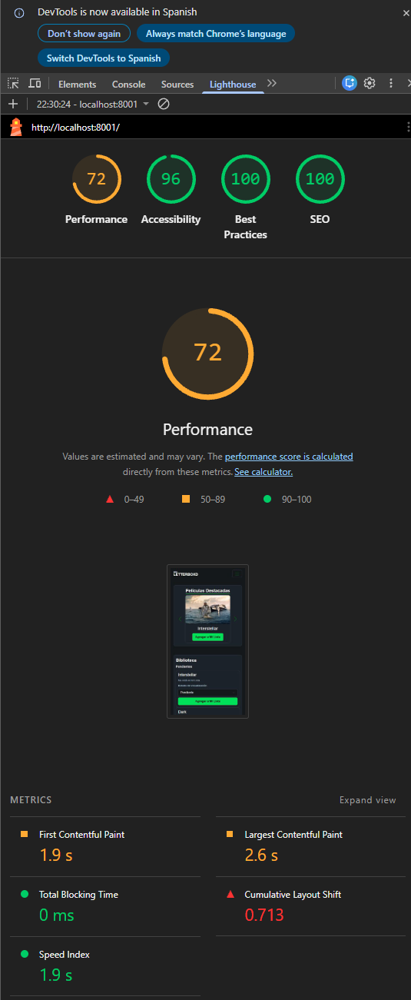
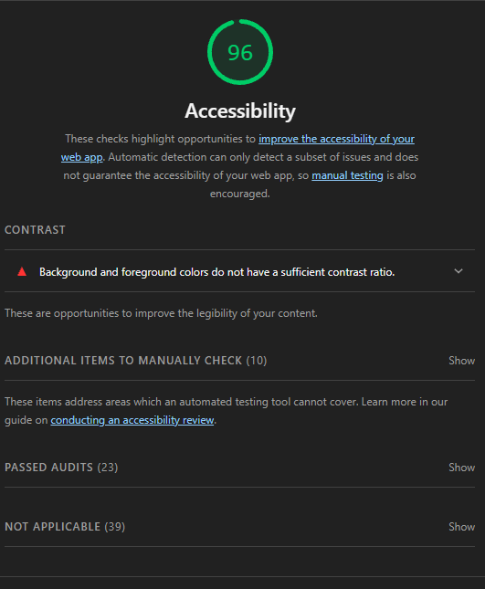

# Test Case 12: Auditoría Lighthouse - Post Fetch/API

## Información General
- **Fecha de ejecución:** [fecha de ejecución]
- **URL testeada:** https://keviineze.github.io/proyecto-web-peliculas/
- **Rama:** develop (con `feature/dev-async-fetch-api` integrada)
- **Navegador:** Chrome 158
- **Dispositivo de auditoría:** Mobile (predeterminado de Lighthouse)
- **Cambios implementados:**
  - Consumo de API [nombre de la API elegida] con fetch
  - Procesamiento asíncrono de datos (map/filter/reduce)
  - Actualización dinámica del DOM

## Resultados Obtenidos

### Performance: [puntaje]
- First Contentful Paint: [tiempo]
- Largest Contentful Paint: [tiempo]
- Total Blocking Time: [tiempo]
- Cumulative Layout Shift: [valor]
- Speed Index: [tiempo]

### Accessibility: [puntaje]
- [Listar problemas encontrados]

### Best Practices: [puntaje]
- [Listar observaciones]

### SEO: [puntaje]
- [Listar observaciones]

## Comparación con Baseline

| Métrica | Baseline | Post-Fetch | Diferencia |
|---------|----------|------------|------------|
| Performance | [TC11] | [TC12] | [±X] [⚠️ / ✅] |
| Accessibility | [TC11] | [TC12] | [±X] [⚠️ / ✅] |
| Best Practices | [TC11] | [TC12] | [±X] [⚠️ / ✅] |
| SEO | [TC11] | [TC12] | [±X] [⚠️ / ✅] |

### Análisis de Impacto
- **Performance:** [indicar si hubo degradación y por qué: llamadas asíncronas, payloads, etc.]
- **Recomendaciones:**
  - [Implementar caché de respuestas API]
  - [Optimizar frecuencia de llamadas]
  - [Considerar lazy loading para datos no críticos]

## Issues Generadas
- [#XX] [Optimizar estrategia de caching para API calls] → asignada a [@Desarrollador JS Asíncrono]
- [#XX] [Reducir tamaño de payload de respuestas API] → asignada a [@Desarrollador JS Asíncrono]

## Conclusiones
[Análisis del impacto de la integración de fetch sobre rendimiento y accesibilidad.]