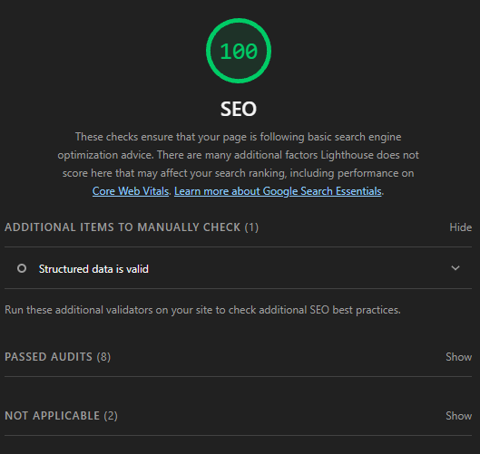

# Test Case 13: Auditoría Lighthouse - Post Integración de Librería Externa

## Información General
- **Fecha de ejecución:** [fecha de ejecución]
- **URL testeada:** https://keviineze.github.io/proyecto-web-peliculas/
- **Rama:** develop (con `feature/dev-libreria-externa-[nombre]` integrada)
- **Navegador:** Chrome 158
- **Dispositivo de auditoría:** Mobile (predeterminado de Lighthouse)
- **Cambios implementados:**
  - Librería [nombre y versión] integrada vía CDN
  - Integrada en [punto 1] y [punto 2] de la aplicación
  - [Otro cambio relevante, si corresponde]

## Resultados Obtenidos

### Performance: [puntaje]
- First Contentful Paint: [tiempo]
- Largest Contentful Paint: [tiempo]
- Total Blocking Time: [tiempo]
- Cumulative Layout Shift: [valor]
- Speed Index: [tiempo]

### Accessibility: [puntaje]
- [Listar problemas encontrados — prestar atención a contraste y ARIA de la librería]

### Best Practices: [puntaje]
- [Listar observaciones — CDN, versiones, advertencias de consola]

### SEO: [puntaje]
- [Listar observaciones]

## Comparación Evolutiva

| Métrica | Baseline (TC11) | Post-Fetch (TC12) | Post-Librería (TC13) | Diferencia vs Post-Fetch |
|---------|-----------------|-------------------|----------------------|--------------------------|
| Performance | [valor] | [valor] | [valor] | [±X] [⚠️ / ✅] |
| Accessibility | [valor] | [valor] | [valor] | [±X] [⚠️ / ✅] |
| Best Practices | [valor] | [valor] | [valor] | [±X] [⚠️ / ✅] |
| SEO | [valor] | [valor] | [valor] | [±X] [⚠️ / ✅] |

### Análisis de Impacto
- **Performance:** [indicar si la librería degradó métricas — scripts de CDN, peso, render]
- **Accessibility:** [si la librería aportó o restó accesibilidad]
- **Recomendaciones finales:**
  - [Prioridad 1]
  - [Prioridad 2]

## Issues Generadas
- [#XX] [Problema encontrado con la integración de la librería] → asignada a [@Desarrollador JS Librerías Externas]

## Conclusiones
[Comparación evolutiva completa: estado final del proyecto tras las tres auditorías y recomendaciones para el Final.]