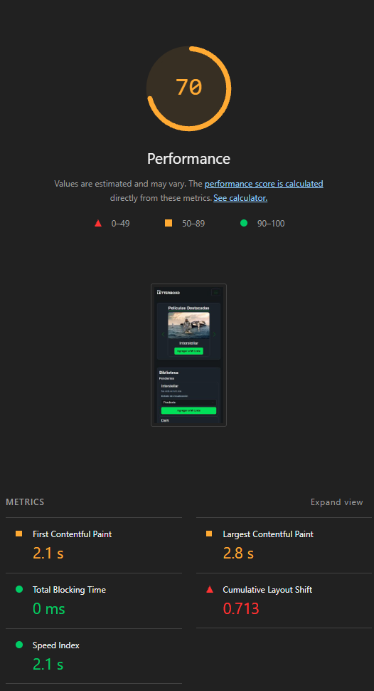
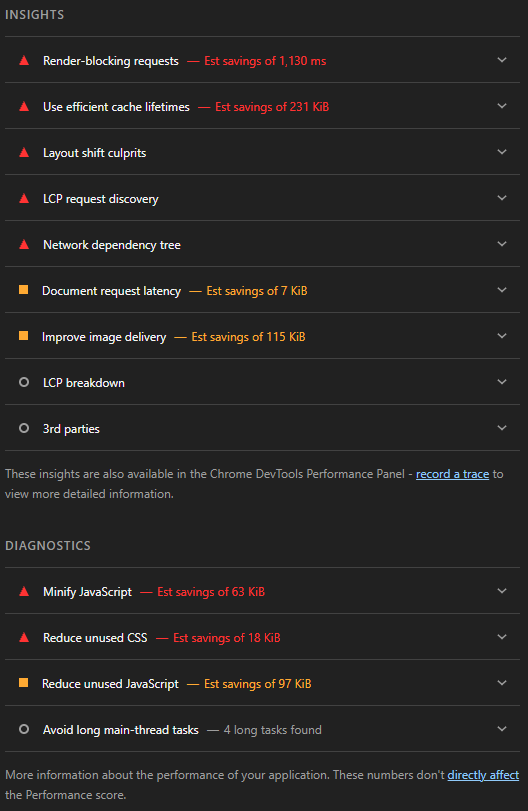
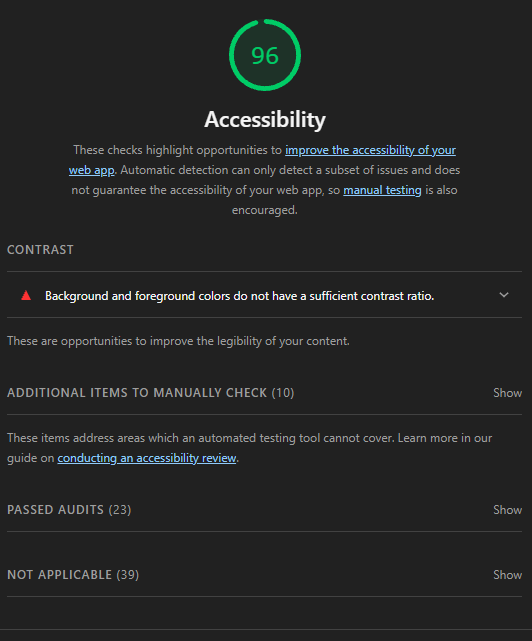
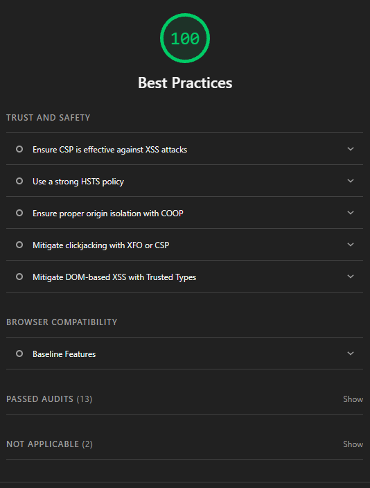

# Test Case 13: Auditoría Lighthouse - Post Integración de Librería Externa

## Información General
- **Fecha de ejecución:** 2026-11-27 — 22:41 a 22:44 (hora local)
- **URL testeada:** http://localhost:8000/ (servidor local `python -m http.server 8000`)
- **Estado auditado:** rama `feature/tester-qa-js-testing-suite` con `origin/develop` mergeado (commit `d7486c0`), que integra la PR #124 (fetch) **y** la PR #125 (`feature/dev-libreria-externa-toastify`) — estado final del proyecto tras ambas features
- **Navegador:** Chrome 158.0.8127.88
- **Dispositivo de auditoría:** Mobile (predeterminado de Lighthouse)
- **Ejecución:** Chrome DevTools → pestaña Lighthouse → categorías Performance, Accessibility, Best Practices y SEO
- **Cambios implementados (respecto al TC12):**
  - **Toastify-js 1.12.0** vía CDN (`cdn.jsdelivr.net`) en dos puntos:
    1. `index.html`: CSS en `<head>` (`toastify.min.css`) y JS con `defer` + SRI (`integrity="sha384-…"`, `crossorigin="anonymous"`)
    2. `js/utils/notifications.js`: wrapper `showToast()` usado por `js/script.js` en 4 acciones (agregar/quitar de Mi Lista, estado de visualización, calificación y compartir Mi Lista)
  - Degradación controlada: si el CDN no responde, la app conserva el feedback inline accesible (cubierto por `library.spec.js`)

> Nota de trazabilidad: misma condición de auditoría que el TC12 (servidor local, mismas máquinas/navegador/preset/red), ya que GitHub Pages sigue publicando `release/cuarta-entrega`. El baseline del TC11 corrió contra Pages.

## Umbrales Mínimos Definidos
- **Performance:** ≥ 95 · **Accessibility:** ≥ 95 · **Best Practices:** ≥ 95 · **SEO:** ≥ 95

## Comparabilidad de las mediciones (corrección tras el Code Review de la PR #128)

Metodología unificada para las tres corridas del parcial:

- **URL única de prueba y mismo entorno** para los tres estados (misma máquina, Chrome 158.0.8127.88, preset Mobile, versión de Lighthouse y red).
- **Caché limpia** en cada ejecución antes de auditar.
- **Mediana de 3 ejecuciones** por estado antes de reportar un valor.

**Alcance real de la comparación actual:**

| Hallazgo | ¿Comparables TC11 (Pages) vs TC12/TC13 (localhost)? | Motivo |
|---|---|---|
| Accessibility, Best Practices, SEO | ✅ Sí | Dependen del HTML y del contenido, no del origen de servicio |
| CLS / layout shift culprits | ✅ Sí, con cautela | Atribuible al layout; verificado 0.71 → 0.713 en los tres estados |
| FCP, LCP, Speed Index, document latency | ❌ No directamente | Distinto origen (HTTPS + CDN vs HTTP local) y distinto estado de caché |
| Render-blocking, cache lifetimes | ❌ No directamente | `python -m http.server` no envía cabeceras `Cache-Control` |

**Comparación válida sin ambigüedad: TC12 ↔ TC13**, ambos servidos por `localhost` en la misma máquina y condiciones: los **+150 ms de render-blocking** (980 → 1.130 ms), las **+2 tareas largas** (2 → 4) y la caída de **72 → 70** en Performance **sí son atribuibles** a la integración de la librería, al compartir origen y entorno. Las columnas del baseline (TC11) se mantienen como referencia histórica, marcadas como no directamente comparables en tiempo y caché.

## Resultados Obtenidos

### Performance: 70 ❌ (umbral ≥ 95)
- First Contentful Paint: 2.1 s
- Largest Contentful Paint: 2.8 s
- Total Blocking Time: 0 ms
- Cumulative Layout Shift: **0.713** ← sigue siendo el responsable principal
- Speed Index: 2.1 s

**Hallazgos (Insights / Diagnostics):**
- 🔴 Render-blocking requests — ahorro estimado de **1.130 ms** (+150 ms respecto al TC12: el CSS de Toastify pasó a bloquear el render)
- 🔴 Use efficient cache lifetimes — ahorro estimado de 231 KiB
- 🔴 Layout shift culprits — origen del CLS 0.713
- 🔴 LCP request discovery
- 🔴 Network dependency tree
- 🟠 Document request latency — ahorro estimado de 7 KiB
- 🟠 Improve image delivery — ahorro estimado de 115 KiB
- 🔴 Minify JavaScript — ahorro estimado de 63 KiB
- 🔴 Reduce unused CSS — ahorro estimado de 18 KiB
- 🟠 Reduce unused JavaScript — ahorro estimado de 97 KiB
- ⚪ Avoid long main-thread tasks — **4 tareas largas detectadas** (TC12: 2 · baseline: 1)
- Passed audits: 16

### Accessibility: 96 ✅ (umbral ≥ 95)
- **Problema persistente del baseline:** *Background and foreground colors do not have a sufficient contrast ratio* → issue #106.
- Passed audits: 23 · Not applicable: 39 · Ítems a verificar manualmente: 10.
- Toastify **no introdujo** nuevos fallos automatizados: el wrapper usa `escapeMarkup: true` y el feedback inline accesible (`role`/`aria-live`) se mantiene como alternativa cuando el CDN no carga. El toast en sí solo aparece tras interacciones del usuario, fuera del alcance de la auditoría automatizada.

### Best Practices: 100 ✅ (umbral ≥ 95)
- Sin observaciones que afecten el puntaje.
- El script de CDN se carga con **SRI (`integrity`) y `crossorigin="anonymous"`**, lo que mantiene el máximo pese a depender de un tercero.
- Passed audits: 13 · Not applicable: 2.

### SEO: 100 ✅ (umbral ≥ 95)
- Sin observaciones: el puntaje alcanza el máximo.
- Passed audits: 8 · Not applicable: 2 · Ítems a verificar manualmente: 1 (*Structured data is valid*).

## Cumplimiento de Umbrales

| Categoría | Umbral | Resultado | ¿Cumple? |
|---|---|---|---|
| Performance | ≥ 95 | 70 | ❌ |
| Accessibility | ≥ 95 | 96 | ✅ |
| Best Practices | ≥ 95 | 100 | ✅ |
| SEO | ≥ 95 | 100 | ✅ |

## Comparación Evolutiva

### Categorías

| Métrica | Baseline (TC11) | Post-Fetch (TC12) | Post-Librería (TC13) | Diferencia vs Post-Fetch |
|---------|-----------------|-------------------|----------------------|--------------------------|
| Performance | 72 | 72 | **70** | −2 ⚠️ (ambos bajo umbral) |
| Accessibility | 96 | 96 | **96** | 0 ✅ |
| Best Practices | 100 | 100 | **100** | 0 ✅ |
| SEO | 100 | 100 | **100** | 0 ✅ |

### Métricas de rendimiento

| Métrica | Baseline (TC11) | Post-Fetch (TC12) | Post-Librería (TC13) | Δ vs TC12 |
|---------|-----------------|-------------------|----------------------|-----------|
| First Contentful Paint | 2.2 s | 1.9 s | 2.1 s | +0.2 s ⚠️ |
| Largest Contentful Paint | 2.4 s | 2.6 s | 2.8 s | +0.2 s ⚠️ |
| Total Blocking Time | 0 ms | 0 ms | 0 ms | 0 ✅ |
| Cumulative Layout Shift | 0.71 | 0.713 | 0.713 | 0 ⚠️ (sin corregir) |
| Speed Index | 2.6 s | 1.9 s | 2.1 s | +0.2 s ⚠️ |

### Hallazgos de Insights / Diagnostics

| Hallazgo | Baseline (TC11) | Post-Fetch (TC12) | Post-Librería (TC13) | Δ vs TC12 |
|----------|----------|------------|----------------------|-----------|
| Render-blocking requests | 890 ms | 980 ms | **1.130 ms** | +150 ms ⚠️ |
| Use efficient cache lifetimes | 156 KiB | 229 KiB | 231 KiB | +2 KiB ⚠️ * |
| Improve image delivery | 115 KiB | 115 KiB | 115 KiB | 0 |
| Reduce unused CSS | 12 KiB | 21 KiB | 18 KiB | −3 KiB ✅ |
| Reduce unused JavaScript | 90 KiB | 97 KiB | 97 KiB | 0 |
| Minify JavaScript | 44 KiB | 63 KiB | 63 KiB | 0 |
| Long main-thread tasks | 1 | 2 | **4** | +2 ⚠️ |

\* Mismo caveat del TC12: en localhost `python -m http.server` no envía `Cache-Control`; auditar en Pages (issue #105).

### Análisis de Impacto
- **Performance (72 → 70, −2 puntos):** la librería externa **costó 2 puntos**. El costo es explicable y acotado: el CSS de Toastify agregado en `<head>` es render-blocking (**+150 ms**, de 980 a 1.130 ms) y el script del CDN suma ejecución en el hilo principal (**4 tareas largas vs. 2**). FCP, LCP y Speed Index retroceden 0.2 s cada uno respecto al TC12. TBT se mantiene en 0 ms: el script está diferido (`defer`) y no bloquea la interacción.
- **Accessibility (96, sin cambios):** la librería **no restó accesibilidad**; el único fallo sigue siendo el contraste del baseline (#106). El wrapper degrada al feedback inline si el CDN falla, cubierto por `library.spec.js`.
- **Best Practices (100, sin cambios):** la dependencia de un tercero no penaliza porque el script se carga con SRI + `crossorigin`.
- **SEO (100, sin cambios):** sin impacto; *structured data* válido.
- **CLS (0.713):** intacto en los tres estados — confirma que es un problema de maquetación previo a ambas features.

### Recomendaciones finales (priorizadas para el cierre del parcial)
1. **Prioridad 1 — CLS 0.713 (issue #104):** es el mayor freno de Performance y no lo ataca ninguna feature. Reservar altura en carrusel/bloques y evitar desplazamientos.
2. **Prioridad 2 — Render-blocking (issues #105 y la nueva del TC13):** cargar el CSS de Toastify de forma no bloqueante (`preload` + `media="print" onload` o inline del CSS crítico) recupera buena parte de los 1.130 ms.
3. **Prioridad 3 — Contraste de texto/fondo (issue #106):** único fallo de Accessibility en los tres estados.
4. **Prioridad 4 — JS sin minificar (63 KiB) y tareas largas (4):** minificar `apiService.js` y revisar el orden de scripts.
5. Caché de `api/data.json` y assets en Pages (issue #105), condición necesaria para medir cache lifetimes en condiciones reales.

## Issues Generadas
- [#127] Hacer no render-blocking el CSS de Toastify (render-blocking 980 → 1.130 ms tras integrar la librería) → @Davidsoria99 (Desarrollador JS Librerías Externas)
- [#104] Reapertura solicitada — CLS 0.713 persistente en los tres estados de auditoría → @GonzaloBarbano (Coordinador/DevOps)

> Issues vigentes heredadas: **#103** (imágenes/LCP), **#105** (render-blocking + caché) y **#106** (contraste). Las issues #103–#106 fueron cerradas por @GonzaloBarbano el 2026-11-27 sin correcciones verificables (los hallazgos siguen presentes en TC12 y TC13); se solicita reapertura o justificación ante el Coordinador/DevOps.

## Conclusiones
Comparación evolutiva completa tras las tres auditorías: **Accessibility 96 → 96 → 96**, **Best Practices 100 → 100 → 100**, **SEO 100 → 100 → 100** (siempre en cumplimiento) y **Performance 72 → 72 → 70** (siempre bajo el ≥95).

Ambas features integradas fueron **controladas**: fetch fue neutral (72 → 72) y la librería costó 2 puntos explicables por el CSS render-blocking del CDN (+150 ms) y 2 tareas largas adicionales, sin efectos en accesibilidad, buenas prácticas ni SEO. El verdadero freno del proyecto es **preexistente**: el CLS de 0.713 y el contraste insuficiente, ambos reportados en el baseline (#104 y #106) y cerrados sin resolución.

**Estado final del proyecto:** 3 de 4 umbrales cumplidos; Performance requiere atacar CLS + render-blocking + minificación de JS para acercarse al ≥95. Con las 5 recomendaciones anteriores resueltas, el puntaje tiene margen claro de recuperación sin afectar las features ya integradas.
