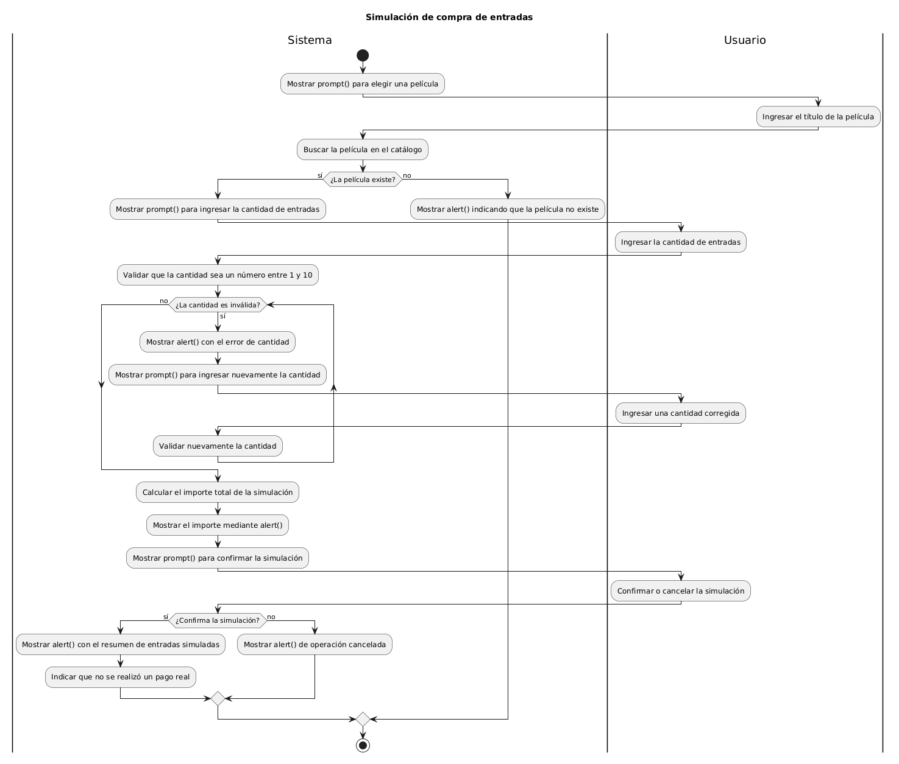
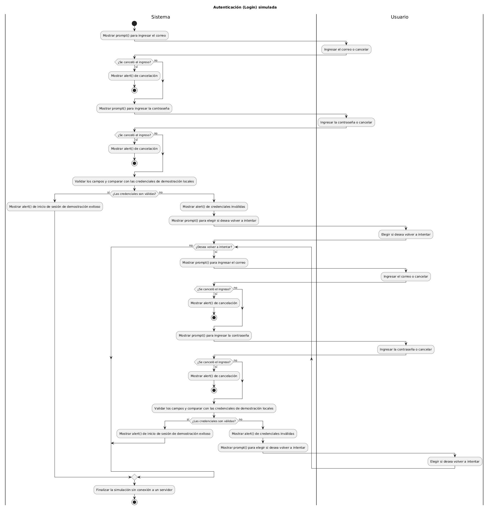

# Índice de Diagramas de Actividades

Este directorio contiene los diagramas de flujo de lógica de negocio que el Desarrollador JavaScript implementará en la tercera entrega.

## Instrucciones de Edición
Los archivos `.puml` contienen el código fuente. Pueden ser editados e interpretados utilizando herramientas web gratuitas como [PlantUML Editor](https://plantumleditor.com/).

---

## 1. Flujo de Búsqueda y Filtrado
Describe la captura del título y género, filtrado del catálogo y la posibilidad de iterar para nuevas búsquedas.
* 📄 **Código fuente:** [actividad-flujo-1-busqueda.puml](./actividad-flujo-1-busqueda.puml)
* 🖼️ **Visualización:**

## 2. Flujo de Simulación de Compra
Describe el proceso de selección de película, validación de cantidad de entradas (con ciclo de error) y confirmación de simulación de pago.
* 📄 **Código fuente:** [actividad-flujo-2-compra.puml](./actividad-flujo-2-compra.puml)
* 🖼️ **Visualización:**

## 3. Flujo de Autenticación (Login)
Modela el ingreso de credenciales simuladas, validación y manejo de intentos fallidos.
* 📄 **Código fuente:** [actividad-flujo-3-login.puml](./actividad-flujo-3-login.puml)
* 🖼️ **Visualización:**

## 4. Flujo de Calificación de Películas
Describe el proceso para calificar una película, verificando primero que exista y que el usuario la haya marcado como vista.
* 📄 **Código fuente:** [actividad-flujo-4-calificacion.puml](./actividad-flujo-4-calificacion.puml)
* 🖼️ **Visualización:**
