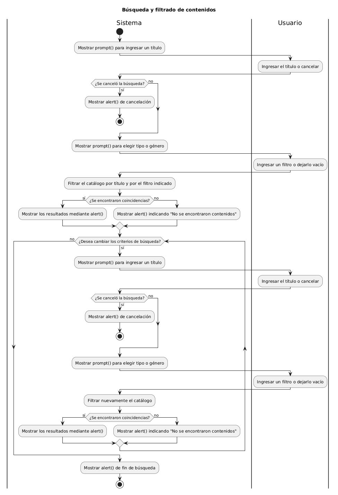
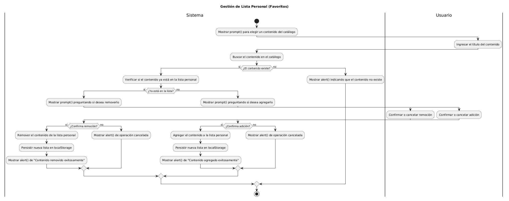
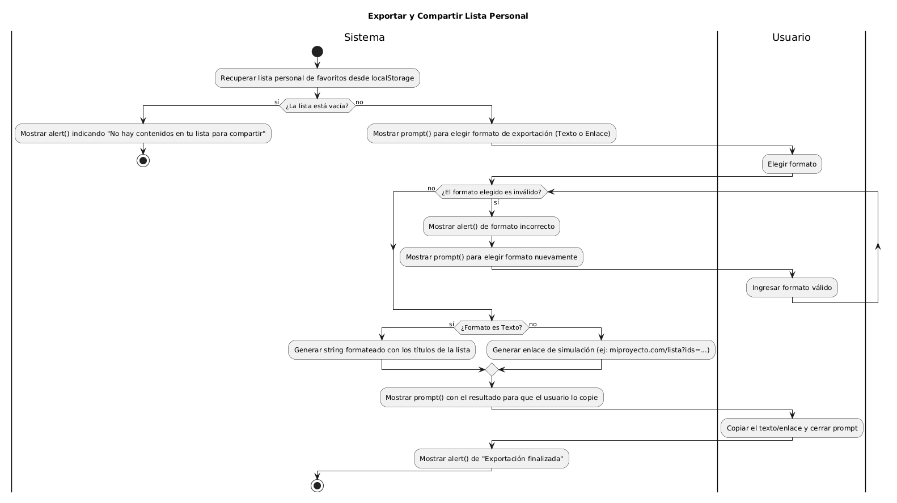
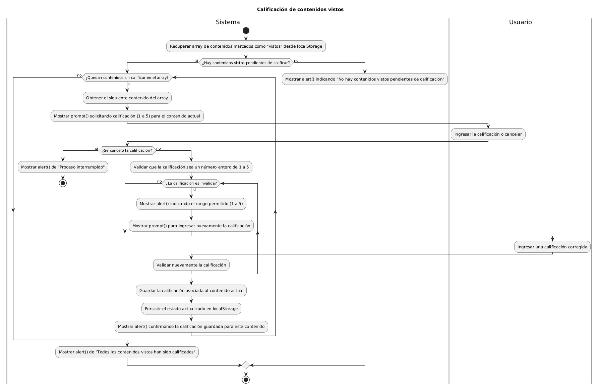

# Índice de Diagramas de Actividades

Este directorio contiene los diagramas de flujo de lógica de negocio que el Desarrollador JavaScript implementará en la Tercera Entrega.

## Instrucciones de Edición
Los archivos `.puml` contienen el código fuente. Pueden ser editados e interpretados utilizando herramientas web gratuitas como [Planttext Editor](https://www.planttext.com//).

---

## 1. Flujo de Búsqueda y Filtrado
Describe la captura del título y género, filtrado del catálogo, la validación de si hay resultados y la posibilidad de iterar para nuevas búsquedas.
* 📄 **Código fuente:** [actividad-flujo-1-busqueda.puml](./actividad-flujo-1-busqueda.puml)
* 🖼️ **Visualización:**

## 2. Flujo de Gestión de Lista Personal (Favoritos)
Describe el proceso de selección de un contenido y la lógica para agregarlo o removerlo de la lista personal del usuario.
* 📄 **Código fuente:** [actividad-flujo-2-Gestión.puml](./actividad-flujo-2-gestion.puml)
* 🖼️ **Visualización:**

## 3. Flujo de Exportar y Compartir Lista Personal
Modela la recuperación de la lista personal y la exportación de la misma mediante un formato de texto o un enlace generado simulado.
* 📄 **Código fuente:** [actividad-flujo-3-Compartir.puml](./actividad-flujo-3-compartir.puml)
* 🖼️ **Visualización:**

## 4. Flujo de Calificación de Contenidos Vistos
Describe el proceso iterativo para recorrer todos los contenidos que el usuario marcó como "vistos" y solicitar una calificación válida (1 a 5) para cada uno.
* 📄 **Código fuente:** [actividad-flujo-4-calificacion.puml](./actividad-flujo-4-calificacion.puml)
* 🖼️ **Visualización:**
