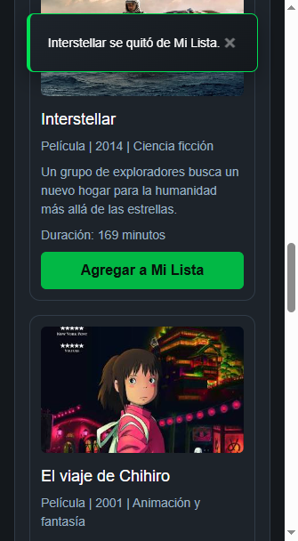
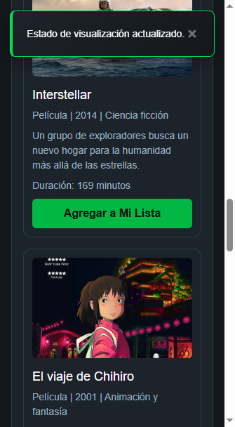

# Toastify-js

## Identificación

- **Nombre:** Toastify-js
- **Versión:** 1.12.0
- **Distribución:** CDN de jsDelivr
- **Uso:** notificaciones breves de confirmación en Mini Letterboxd.

## Justificación

Toastify-js es liviana, no requiere dependencias adicionales y permite dar
feedback visual inmediato sin interrumpir la navegación. Sus avisos están
personalizados con el fondo oscuro y los acentos verde y azul del tema. El
feedback accesible que ya se muestra en el DOM se mantiene; el helper no-op
cuando la librería no está disponible, como ocurre en el runner Jasmine.

## Instalación vía CDN

El CSS se carga en el `<head>` y el JavaScript usa `defer` para no bloquear el
parseo del documento:

```html
<link
  rel="stylesheet"
  href="https://cdn.jsdelivr.net/npm/toastify-js@1.12.0/src/toastify.min.css"
/>
<script
  defer
  src="https://cdn.jsdelivr.net/npm/toastify-js@1.12.0/src/toastify.min.js"
></script>
```

La aplicación encapsula la llamada global en `js/utils/notifications.js`.
`showToast(message, type)` admite los tipos `success`, `warning`, `error` e
`info`, con `info` como valor predeterminado.

## Ejemplos usados en el proyecto

### Agregar o quitar un título de Mi Lista

En `js/script.js`, el aviso refleja el título y la acción confirmada:

```js
const message = isFavorite
  ? `${content.getTitle()} se agregó a Mi Lista.`
  : `${content.getTitle()} se quitó de Mi Lista.`;
renderMessage(document.getElementById("library-feedback"), message, "success");
showToast(message, "success");
```

### Cambiar el estado o calificación en Biblioteca

Tras guardar correctamente una actualización:

```js
showToast("Estado de visualización actualizado.", "success");
// Al guardar una calificación válida:
showToast("Calificación guardada.", "success");
```

### Preparar una exportación de Mi Lista

Al preparar el formato seleccionado para copiar o compartir:

```js
showToast("Mi Lista está lista para compartir.", "success");
```

## Evidencias visuales

- Toast al agregar o quitar un título de Mi Lista:
  
- Toast al confirmar una acción de Biblioteca:
  
