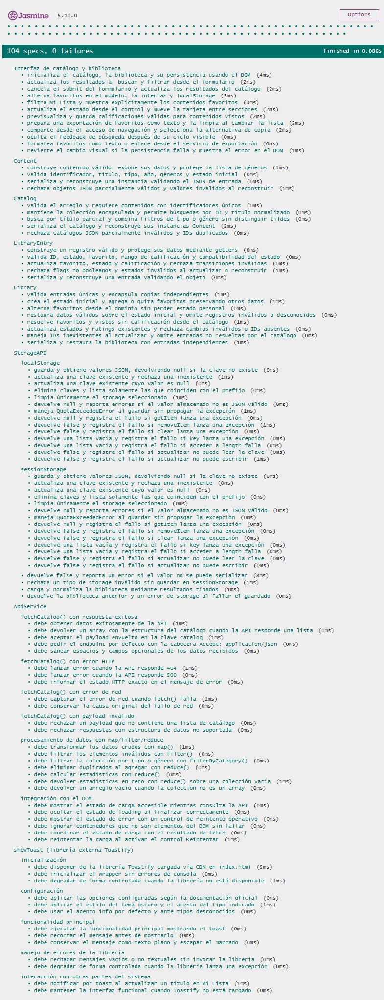
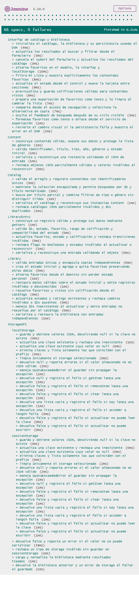
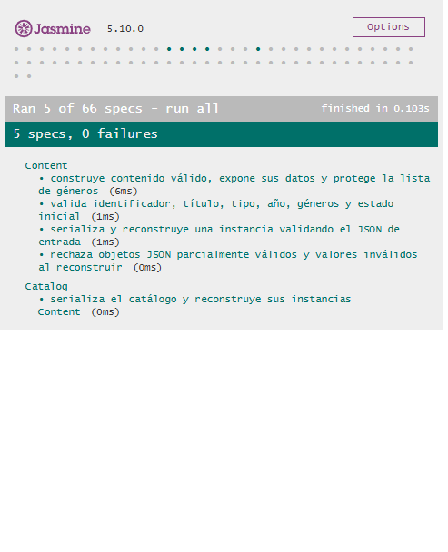
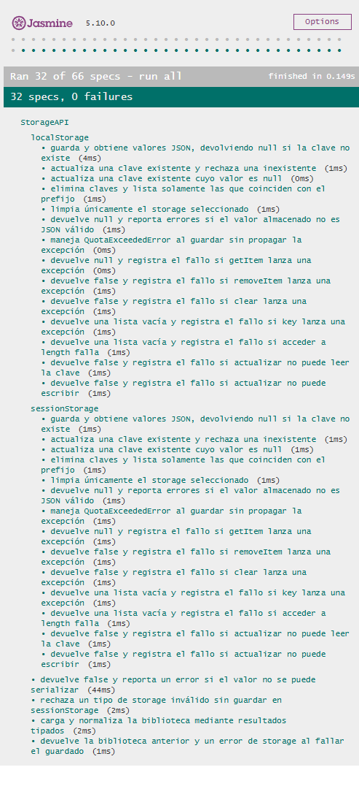
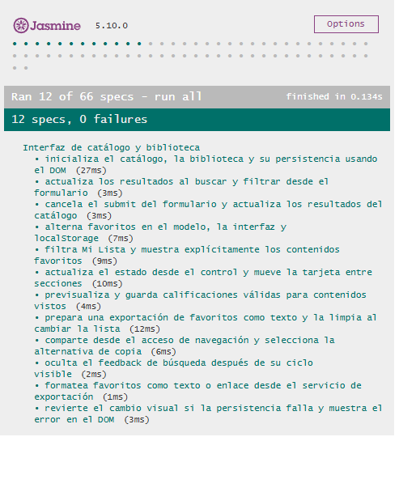

# Pruebas automatizadas

## Ejecución

Desde la raíz del proyecto, inicia un servidor HTTP local:

```bash
python -m http.server 8000
```

Abre `http://localhost:8000/js/test/test-runner.html` en el navegador. Jasmine 5.10.0 se carga desde `js/test/vendor/jasmine-5.10.0/` y ejecuta automáticamente las cinco suites. El servidor es necesario para que el navegador permita cargar los módulos ES.

## Suites

- `models.spec.js`: constructores, validaciones, operaciones, encapsulamiento y serialización de `Content`, `Catalog`, `LibraryEntry` y `Library`, incluidos JSON parcialmente inválido e IDs inexistentes.
- `storage.spec.js`: operaciones CRUD de `StorageAPI` en `localStorage` y `sessionStorage`, además de fallos simulados en lectura, eliminación, limpieza, listado y actualización, JSON corrupto, serialización y cuota excedida.
- `script.spec.js`: integración de la interfaz con el catálogo, la biblioteca, la búsqueda, los filtros de Mi Lista, los controles de calificación, compartir y la persistencia.
- `api.spec.js` *(Segundo Parcial)*: `ApiService.fetchCatalog()` con respuesta exitosa (lista y payload envuelto en `catalog`), error HTTP (404/500/403), error de red con conservación de `cause`, payload inválido, procesamiento con `map`/`filter`/`reduce` (`processCollection`, `filterByCategory`, `calculateStats`) e integración con el DOM (`showLoading`, `hideLoading`, `showError` con botón "Reintentar"). Mock de `fetch` mediante `spyOn(window, "fetch")`.
- `library.spec.js` *(Segundo Parcial)*: wrapper `showToast()` de `js/utils/notifications.js` sobre la librería externa **Toastify-js 1.12.0** — inicialización (carga vía CDN con SRI en `index.html`), configuración (duration, gravity, position, acento por tipo), funcionalidad principal, manejo de errores (mensajes inválidos, librería ausente o lanzando excepción) e interacción con el sistema (actualización de Mi Lista con y sin Toastify disponible).

Las suites se ejecutan en el navegador y el reporte de Jasmine muestra el total de specs y fallos.

## Limitaciones

- Las pruebas de interfaz usan un DOM reducido incluido en el runner; no validan estilos ni el diseño visual de `index.html`.
- `library.spec.js` carga `index.html` vía `fetch` para validar la etiqueta del CDN, por lo que la suite requiere el servidor HTTP local (no corre sobre `file://`).

## Resultados y Evidencias

- **Última ejecución:** 2026-11-27 — **104 specs, 0 failures (100% PASS)** en Jasmine 5.10.0 (66 specs existentes + 38 nuevos: 25 de `api.spec.js` y 13 de `library.spec.js`).
- **Capturas de resultados:**










