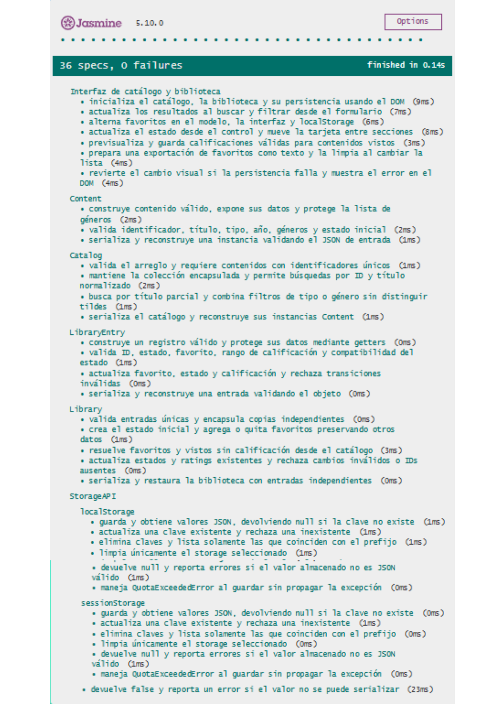

# Pruebas automatizadas

## Ejecución

Desde la raíz del proyecto, inicia un servidor HTTP local:

```bash
python -m http.server 8000
```

Abre `http://localhost:8000/js/test/test-runner.html` en el navegador. Jasmine 5.10.0 se carga desde `js/test/vendor/jasmine-5.10.0/` y ejecuta automáticamente las tres suites. El servidor es necesario para que el navegador permita cargar los módulos ES.

## Suites

- `models.spec.js`: constructores, validaciones, operaciones, encapsulamiento y serialización de `Content`, `Catalog`, `LibraryEntry` y `Library`, incluidos JSON parcialmente inválido e IDs inexistentes.
- `storage.spec.js`: operaciones CRUD de `StorageAPI` en `localStorage` y `sessionStorage`, además de fallos simulados en lectura, eliminación, limpieza, listado y actualización, JSON corrupto, serialización y cuota excedida.
- `script.spec.js`: integración de la interfaz con el catálogo, la biblioteca, la búsqueda y el submit del formulario, los controles de calificación, la exportación y la persistencia.

Las suites se ejecutan en el navegador y el reporte de Jasmine muestra el total de specs y fallos.

## Limitaciones

- Las pruebas de interfaz usan un DOM reducido incluido en el runner; no validan estilos ni el diseño visual de `index.html`.

## Resultados y Evidencias

- **Última ejecución:** 60 specs, 0 failures (100% PASS) — 0.144s en Jasmine 5.10.0, ejecutadas en Chromium mediante Playwright MCP, sin errores de consola ni excepciones de página.
- **Captura de resultados:**


