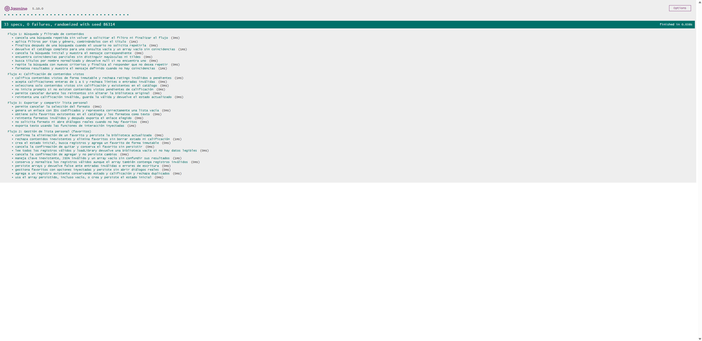
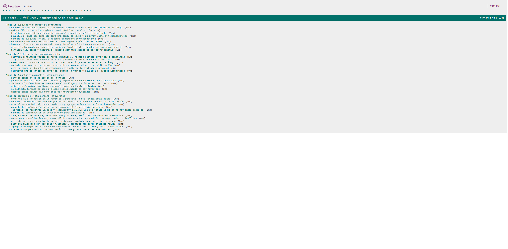

# Documentación de Testing - Suite Jasmine

## Índice
1. [Ejecución de Tests](#ejecución-de-tests)
2. [Suites de Tests](#suites-de-tests)
3. [Métricas de Cobertura](#métricas-de-cobertura)
4. [Capturas de Pantalla](#capturas-de-pantalla)
5. [Issues Conocidos](#issues-conocidos)

---

## Ejecución de Tests

### Pasos para Ejecutar
1. Desde la raíz del proyecto, iniciar un servidor local:
   ```bash
   python -m http.server 8000
   ```
2. Abrir `http://localhost:8000/js/test/test-runner.html` en el navegador.
3. Jasmine 5.10.0, cargado mediante CDN, ejecuta automáticamente `js/test/script.spec.js`.
4. Verificar el resumen y los resultados de cada suite en la interfaz de Jasmine.

### Interpretación de Resultados
- **Verde**: Tests pasando ✅
- **Rojo**: Tests fallando ❌
- **Amarillo**: Tests pendientes ⚠️
- Resultado confirmado en la ejecución documentada: `45 specs, 0 failures`.

---

## Suites de Tests

### Suite 1: Búsqueda y filtrado de contenidos (12 tests)
**Funciones Testeadas:**
- `searchContents()` - búsqueda parcial y filtros por tipo y género, con normalización de mayúsculas y tildes.
- `findTitleByName()` - búsqueda exacta normalizada y resultado nulo cuando no hay coincidencia.
- `formatSearchResults()` - presentación de resultados y mensaje para búsquedas vacías.
- `runSearchFlow()` y `askYesNo()` - cancelación inicial y repetida, repetición con nuevos criterios, respuesta inválida con reintento, cancelación/no coincidencia del filtro y finalización.

**Casos de Prueba:**
| # | Descripción | Tipo |
|---|-------------|------|
| 1 | Buscar títulos con coincidencias parciales y normalización de texto. | Happy Path |
| 2 | Filtrar por tipo y género, y combinar el filtro con el título. | Happy Path |
| 3 | Devolver catálogo completo con búsqueda vacía y ningún resultado si no hay coincidencias. | Caso Borde |
| 4 | Encontrar un título normalizado o devolver `null`. | Caso Borde |
| 5 | Formatear resultados y el mensaje de lista vacía. | Happy Path |
| 6 | Cancelar al ingresar el título inicial. | Cancelación |
| 7 | Repetir la búsqueda con nuevos criterios y luego finalizar. | Happy Path |
| 8 | Finalizar al responder que no se desea repetir. | Happy Path |
| 9 | Cancelar durante una búsqueda repetida. | Cancelación |
| 10 | Reintentar la confirmación de repetición tras una respuesta inválida. | Validación |
| 11 | Tratar la cancelación del filtro como filtro vacío. | Cancelación |
| 12 | Mostrar el mensaje correspondiente cuando el filtro no tiene coincidencias. | Caso Borde |

---

### Suite 2: Gestión de lista personal (favoritos) (15 tests)
**Funciones Testeadas:**
- `createInitialLibrary()`, `findLibraryRecord()` - estado inicial y consulta de registros.
- `addFavorite()` y `removeFavorite()` - altas y bajas inmutables, duplicados, contenido inexistente y conservación del estado/calificación.
- `readStoredLibrary()`, `loadLibrary()`, `getWorkingLibrary()` y `saveLibrary()` - lectura, normalización, inicialización y persistencia simulada.
- `runFavoritesFlow()` - confirmaciones y cancelaciones de altas y bajas, con persistencia.

**Casos de Prueba:**
| # | Descripción | Tipo |
|---|-------------|------|
| 1 | Crear biblioteca inicial, buscar registros y agregar un favorito sin mutar el estado original. | Happy Path |
| 2 | Agregar a un registro existente conservando estado y calificación; rechazar duplicados. | Caso Borde |
| 3 | Rechazar contenido inexistente y quitar el favorito sin borrar otros datos. | Validación |
| 4 | Manejar clave inexistente, JSON inválido y array vacío. | Caso Borde |
| 5 | Conservar registros válidos y normalizarlos aunque coexistan registros inválidos. | Validación |
| 6 | Leer arrays válidos y devolver biblioteca vacía cuando no hay datos legibles. | Happy Path |
| 7 | Usar biblioteca vacía persistida o inicializar y persistir la biblioteca por defecto. | Persistencia |
| 8 | Guardar arrays y manejar argumentos inválidos o errores de escritura. | Validación |
| 9 | Confirmar un alta y persistirla desde el flujo interactivo. | Happy Path |
| 10 | Confirmar la baja de un favorito y persistir la biblioteca actualizada. | Happy Path |
| 11 | Cancelar la confirmación de un alta sin guardar cambios. | Cancelación |
| 12 | Cancelar la confirmación de una baja y conservar el favorito. | Cancelación |
| 13 | Informar que el título solicitado no existe en el catálogo. | Validación |
| 14 | Informar la cancelación del ingreso del título. | Cancelación |
| 15 | Informar un fallo de `saveLibrary()` sin cambiar la biblioteca en memoria. | Error de persistencia |

---

### Suite 3: Exportar y compartir lista personal (8 tests)
**Funciones Testeadas:**
- `getFavoriteContents()` - seleccionar favoritos presentes en el catálogo.
- `formatFavoritesAsText()` - exportación en texto.
- `createFavoritesLink()` - generación del enlace simulado con IDs codificados.
- `runSharingFlow()` - selección de formato, reintentos, cancelación y lista vacía.

**Casos de Prueba:**
| # | Descripción | Tipo |
|---|-------------|------|
| 1 | Obtener favoritos válidos, formatear el texto y representar lista vacía. | Happy Path |
| 2 | Generar enlace con IDs codificados y enlace para lista vacía. | Happy Path |
| 3 | No solicitar formato cuando no hay favoritos. | Caso Borde |
| 4 | Exportar texto mediante funciones de interacción simuladas. | Happy Path |
| 5 | Reintentar tras un formato inválido y exportar el enlace. | Validación |
| 6 | Cancelar la selección del formato. | Cancelación |
| 7 | Cargar la biblioteca desde storage sin inyectar `library` y exportar sus favoritos. | Persistencia |
| 8 | Informar que la biblioteca cargada desde storage no tiene favoritos. | Caso Borde |

---

### Suite 4: Calificación de contenidos vistos (10 tests)
**Funciones Testeadas:**
- `validateRating()` - validación de enteros de 1 a 5 y rechazo de valores inválidos.
- `getUnratedWatchedContents()` - selección de contenidos vistos pendientes de calificación.
- `rateWatchedContent()` - asignación inmutable de calificaciones y rechazo de contenidos pendientes.
- `runRatingFlow()` - reintentos, cancelación, actualización y persistencia.

**Casos de Prueba:**
| # | Descripción | Tipo |
|---|-------------|------|
| 1 | Aceptar calificaciones enteras válidas de 1 a 5 y rechazar valores inválidos. | Validación |
| 2 | Seleccionar vistos sin calificación, excluyendo pendientes, ya calificados o ausentes del catálogo. | Caso Borde |
| 3 | Calificar un contenido visto sin mutar la biblioteca y rechazar ratings inválidos o estado pendiente. | Happy Path |
| 4 | Reintentar un valor inválido, persistir el rating válido y completar el flujo. | Validación |
| 5 | Cancelar durante los reintentos sin alterar ni persistir la biblioteca. | Cancelación |
| 6 | No solicitar ratings si no quedan contenidos vistos pendientes. | Caso Borde |
| 7 | Informar un fallo de `saveLibrary()` y conservar la biblioteca original. | Error de persistencia |
| 8 | Salir del menú con la opción `0`. | Menú |
| 9 | Informar una opción inválida y permitir salir. | Menú |
| 10 | Despachar las opciones `1` a `4` a sus flujos correspondientes. | Menú |

---

## Métricas de Cobertura

### Resumen General
| Métrica | Valor |
|---------|-------|
| Suites ejecutadas | 4 |
| Tests ejecutados | 45 |
| Tests aprobados | 45 ✅ |
| Tests fallidos | 0 |
| Líneas de `js/script.js` cubiertas | 212/231 (91,77%) |
| Ramas de `js/script.js` cubiertas | 138/173 (79,77%) |

### Análisis de Cobertura de Código

La medición se ejecutó el 02/11/2026 con `istanbul-lib-instrument` 6.0.3 sobre `js/script.js`, junto con las cuatro suites Jasmine. Se cubrieron 212 de 231 líneas y 138 de 173 ramas. La cobertura no es 100%; los valores registrados corresponden al código ejercitado por las 45 pruebas. El instrumentador se usó de forma temporal y sus archivos auxiliares no forman parte del repositorio.

---

## Capturas de Pantalla

### Tests Pasando

*Captura existente de una ejecución anterior: 33 specs, 0 failures. Los resultados vigentes de 45 specs y la medición de cobertura están registrados en la tabla anterior.*

### Vista Detallada de Suites

*Captura existente de una ejecución anterior; las cantidades actuales por suite están documentadas arriba.*

---

## Issues Conocidos

No se detectaron tests fallidos ni bugs que requirieran crear una nueva Issue durante esta ejecución.

Como observación menor, el navegador solicitó automáticamente `http://localhost:8000/favicon.ico` y recibió `404 (File not found)`. El runner, `script.js` y `script.spec.js` cargaron correctamente; no se observaron errores de JavaScript y las cuatro suites finalizaron sin fallos. El 404 no afectó la ejecución de Jasmine y no constituye un fallo de testing.

---

## Limitaciones del Testing

- La ejecución utiliza Jasmine mediante CDN y requiere conexión a internet para cargar sus recursos.
- Las pruebas ejercitan la lógica JavaScript con fixtures y mocks; no son pruebas de integración visual con el DOM de la aplicación.
- Las capturas guardadas corresponden a una ejecución previa de 33 pruebas; las métricas vigentes están transcritas en este documento.
- El 404 del favicon en la raíz es una observación del servidor local, no bloqueante para el runner.

---

**Última Actualización:** 02/11/2026
**Tester/QA Engineer:** Kevin Ezequiel Sosa
**Colaboración con:** Desarrollador JavaScript de Mini Letterboxd
